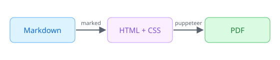

# 샘플 문서

한국어 텍스트 렌더링 테스트입니다. **굵게**, *기울임*, ~~취소선~~, `인라인 코드`.

## 표

| 항목 | 값 |
|------|----|
| 언어 | Node.js |
| 엔진 | puppeteer |

## 이미지

로컬 이미지(상대 경로)도 들어갑니다.



## 코드 블록

```js
function hello(name) {
  return `안녕하세요, ${name}!`;
}
```

## 수식

인라인 수식: $E = mc^2$, 근의 공식은 $x = \frac{-b \pm \sqrt{b^2 - 4ac}}{2a}$ 입니다.

$$
\int_{-\infty}^{\infty} e^{-x^2}\,dx = \sqrt{\pi}
$$

## 체크리스트

- [x] Markdown 파싱
- [x] 코드 하이라이팅
- [ ] 목차 자동 생성

> 인용문 테스트

- 목록 1
- 목록 2
